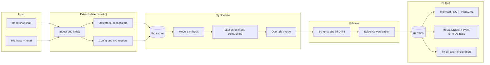

# code2design: Design Document

**Status:** Proposal, v0.1
**Scope:** A tool that takes a repository snapshot or a pull request and produces a design view of the system: a leveled data flow diagram (DFD), per-entry-point control flows, and a machine-readable element inventory suitable for threat modeling.

---

## 1. Goals and non-goals

### Goals

1. **Accurate.** Every box and arrow on the diagram can be traced back to specific code. The tool prefers saying "unknown" over guessing, and visibly marks anything it inferred rather than observed.
2. **Consistent.** The same input always produces the same output, byte for byte. Two people running it on the same commit get identical diagrams. A PR produces a stable, reviewable delta rather than a re-drawn picture.
3. **Clear.** Diagrams are leveled, bounded in size, use one fixed notation, and name things the way the code and the team name them.
4. **Reusable downstream.** The primary output is a structured model, not a picture. Pictures, threat-model files, and PR comments are all renderings of that model.

### Non-goals (for v1)

* Full-program dataflow analysis (taint tracking to the variable level). We model flows between architectural elements, not between expressions.
* Runtime tracing. The design allows optional runtime evidence (OpenTelemetry traces, access logs) as a later input, but v1 is static.
* UI/UX diagrams, class diagrams, or ER diagrams.
* Fully automatic threat *enumeration*. We produce the inputs a threat model needs (elements, flows, boundaries, data classes, controls) and a STRIDE-per-element starting table. Risk rating stays with humans.

---

## 2. Vocabulary

The tool uses the classic DFD element set with a few security-oriented attributes, because that is what threat-modeling tools and reviewers already understand.

| Element            | Meaning in this tool                                                                              | Typical code evidence                                   |
|--------------------|---------------------------------------------------------------------------------------------------|---------------------------------------------------------|
| External entity    | An actor or system outside the code under analysis that sends or receives data.                   | HTTP route handler (caller side), outbound HTTP client, SDK client for a third-party service, CLI invocation, message consumer. |
| Process            | A unit of the system that transforms data. Hierarchical: a service at L0, a module at L1, a handler or job at L2. | Package/module boundaries, route handlers, workers, scheduled jobs. |
| Data store         | Anything that persists or buffers data.                                                           | DB client construction, ORM models, cache clients, queue/topic clients, filesystem writes, object-storage SDKs. |
| Data flow          | Directed movement of data between two elements, with a protocol and a data classification.        | Call edges between elements, request/response schemas, message payload types. |
| Trust boundary     | A line across which the level of trust changes. Contains elements.                                | Network edge (ingress), process/container boundary, auth middleware, IAM role, VPC/subnet from IaC. |
| Control            | A security-relevant mechanism attached to a flow or element.                                      | Auth middleware, input validation, TLS config, rate limiter, encryption calls, authorization checks. |

**Levels.**
* **L0 (context):** the whole repository as one process, plus every external entity and data store it touches.
* **L1:** the repository decomposed into top-level processes (services, apps, or packages, depending on repo shape).
* **L2:** one L1 process decomposed into entry points and the internal processes they call.

**Control flow view.** For each entry point (route, consumer, job, command), the ordered chain of processes it passes through: middleware, handler, service, repository, store, outbound calls. Rendered as a sequence diagram or a flowchart. This is the "how does a request move" view; the DFD is the "what talks to what and with which data" view. Both come from the same IR.

---

## 3. How the three quality properties are achieved

This section is the heart of the design. Everything in later sections exists to serve one of these three.

### 3.1 Accuracy

**Evidence-first model.** The IR forbids an element or flow without at least one `evidence` entry (`path`, `line range`, `commit`, and the detector that produced it). The renderer refuses to draw an unevidenced element. This is a schema constraint, not a convention.

**Observed vs. inferred.** Every element and flow carries `origin: observed | inferred | declared`:
* `observed` comes from a deterministic detector reading code or config.
* `declared` comes from a human override file checked into the repo.
* `inferred` comes from the LLM enrichment stage or from a heuristic. It carries a `confidence` in [0,1] and a `rationale` string. Inferred items render with a dashed outline and are listed separately in the report.

**Static analysis does the structure; the language model does the labeling.** The call graph, entry points, store clients, and outbound clients are found by parsers and framework recognizers. The language model is only allowed to: name and describe processes, group functions into a process when the module structure is ambiguous, classify data sensitivity of a schema, and propose a purpose for a flow. It cannot create an element or a flow. Every LLM proposal must reference existing fact IDs; proposals that reference nothing are discarded.

**Closed-world detectors with explicit coverage.** Each framework recognizer declares what it can and cannot see (for example, "Express: detects `app.<verb>` and `router.<verb>` with literal paths; does not resolve dynamically built routers"). The report lists the recognizers that ran and the files that no recognizer understood, so a reader knows where the blind spots are.

**Verification pass.** After synthesis, a checker re-derives a sample of claims from the raw facts: every flow's endpoints exist, every evidence span exists in the commit, every entry point maps to a real symbol. Any failure is a hard error, not a warning.

**Ground-truth benchmark.** A curated set of repositories with hand-made DFDs. Node and flow precision/recall are computed on every change to the tool (see section 10).

### 3.2 Consistency

**Single canonical IR.** All inputs converge to one JSON document (`schema/dfd-ir.schema.json`). All outputs are produced from it. No renderer reads source code.

**Content-addressed stable IDs.** An element's ID is a hash of its *identity tuple*, not its position or discovery order:
* Process: `(kind=process, repo-relative module path, symbol name)`
* External entity: `(kind=external, canonical host or SDK service name, direction)`
* Data store: `(kind=store, technology, logical name)` where the logical name is the table/bucket/topic/collection when known, else the client variable's declaring module.
* Flow: `(source id, target id, protocol, payload type)`

IDs survive refactors that move files only when the identity tuple is unchanged; a rename is a delete plus an add, which is what a reviewer would expect. Renames can be reconciled in the override file.

**Deterministic pipeline.** No wall-clock time, no random seeds, no map iteration order leaks. All collections are sorted by ID before serialization and before layout. The LLM stage runs at temperature 0 with a pinned model, its output is cached by input hash, and its proposals are *validated and canonicalized* before entering the IR, so an upstream model change can alter a label but never the graph structure.

**Deterministic layout.** Rendering uses explicit ordering (by level, then by ID) and fixed subgraph nesting. Mermaid and DOT output are text, so diffs between runs are reviewable. For PR mode we diff the IR, never the picture.

**Controlled vocabulary.** Protocols, store technologies, data classifications, and control kinds are enumerations in the schema. A detector cannot emit "Postgres", "postgres", and "PostgreSQL" as three technologies.

**Determinism test.** CI runs the pipeline twice on the benchmark and fails if any byte differs.

### 3.3 Clarity

**Leveling with hard budgets.** Each rendered diagram has a maximum of 25 nodes and 40 edges by default. When an L1 view exceeds the budget, the tool collapses the smallest processes into their parent and emits an L2 view for the parent instead. Collapsing is deterministic (smallest by evidence count, ties by ID).

**One notation.** Gane-Sarson shapes: rectangles for external entities, rounded rectangles for processes, open-ended rectangles for stores, dashed boxes for trust boundaries. Edge labels carry `protocol: payload`. A legend is always rendered.

**Naming rules.** Process names come from code identifiers, de-camel-cased and de-snaked, never from LLM prose unless the identifier is meaningless (`handler1`). External entities are named by hostname or SDK service (`Stripe API`, `S3: invoices-bucket`). Stores are named `Technology: logical-name`. Names are unique within a diagram; collisions get a disambiguating suffix from the module path.

**Focus views.** Besides the leveled DFDs, the tool emits one control-flow view per entry point and one "neighborhood" view per data store (everything that reads or writes it). Reviewers rarely want the whole graph; they want "what touches the users table".

**Boundaries are always drawn.** A DFD without trust boundaries is not useful for threat modeling, so if no boundary can be derived, the tool draws the single default boundary ("this repository") and flags the gap in the report.

---

## 4. Architecture



The pipeline is a sequence of pure functions over files. Each stage writes its output to the work directory so any stage can be re-run and inspected on its own:

```
.code2design/
  facts.jsonl          # raw detector output, one fact per line
  model.ir.json        # canonical IR
  report.md            # coverage, gaps, inferred items, lint results
  diagrams/            # rendered views
  exports/             # threat-model exports
```

---

## 5. Stage details

### 5.1 Ingest and index

* Accepts a local path, a git URL plus ref, or `owner/repo#pr`. PR mode resolves base and head SHAs and runs the rest of the pipeline on both.
* Detects languages and frameworks from manifests (`package.json`, `pyproject.toml`, `go.mod`, `pom.xml`, `Cargo.toml`, `*.csproj`) and from file extensions.
* Builds a syntax index with tree-sitter for every supported language, and a cross-reference index with SCIP (Sourcegraph Code Intelligence Protocol) when an indexer is available for the language. SCIP gives definition/reference resolution across files, which is what turns "this function calls `db.query`" into "this module writes the orders table".
* Records the exact commit, the tool version, and the recognizer versions in the IR `provenance` block.

### 5.2 Detectors (fact extraction)

A detector is a small, testable function: `(index, file) -> [Fact]`. Facts are flat records, never graphs:

```json
{"kind": "entry_point", "protocol": "http", "method": "POST", "path": "/orders",
 "symbol": "src/orders/routes.ts::createOrder", "evidence": {"path": "src/orders/routes.ts", "start": 42, "end": 58}, "detector": "express-routes@1.2"}
```

Fact kinds:

| Fact kind         | Produced by                                                                                     |
|-------------------|-------------------------------------------------------------------------------------------------|
| `entry_point`     | HTTP/gRPC/GraphQL route recognizers, message consumer recognizers, CLI command recognizers, scheduler recognizers. |
| `outbound_call`   | HTTP client recognizers (fetch, axios, requests, net/http), SDK recognizers (AWS, GCP, Stripe, Twilio, SendGrid), gRPC stubs. |
| `store_access`    | DB drivers and ORMs (pg, Prisma, SQLAlchemy, GORM, JDBC, Mongo), cache clients, queue producers, filesystem and object-storage writes. Includes `operation: read | write | delete` when determinable. |
| `call_edge`       | Call graph edges between symbols, from SCIP or tree-sitter plus heuristic resolution.          |
| `module`          | Package/module structure with a size metric.                                                   |
| `schema`          | Request/response/message/row types: TypeScript interfaces, Pydantic models, protobufs, OpenAPI, JSON Schema, ORM models. Field names and types are kept for data classification. |
| `control`         | Auth middleware registration, validation decorators, TLS settings, rate limiters, crypto calls, authorization checks (`@PreAuthorize`, `requireRole`). |
| `boundary_hint`   | Dockerfiles, compose services, Kubernetes manifests, Terraform resources (VPC, subnet, security group, IAM role), serverless configs, env-var reads of secrets. |
| `config_value`    | Resolved string constants for hosts, ports, bucket names, topic names, table names, when they are literal or trace to an env var name. |

Design rules for detectors:
* Each detector has a **coverage statement** and a **false-positive policy** in its docstring, and both are surfaced in the report.
* Detectors never call the LLM.
* Detectors are versioned; the version is part of the fact and the IR provenance, so output changes can be attributed.
* Unknown dynamic constructs produce an `unresolved` fact rather than nothing, so the gap is visible.

**Initial recognizer catalog (v1 target).**

| Language   | Entry points                                  | Outbound / stores                                             |
|------------|-----------------------------------------------|---------------------------------------------------------------|
| TypeScript | Express, Fastify, NestJS, Next.js API routes  | fetch, axios, pg, Prisma, TypeORM, ioredis, kafkajs, aws-sdk v3 |
| Python     | FastAPI, Flask, Django, Celery, Click         | requests, httpx, SQLAlchemy, Django ORM, psycopg, redis, boto3, pika |
| Go         | net/http, chi, gin, gRPC servers, cobra       | net/http client, database/sql, GORM, go-redis, sarama, aws-sdk-go |
| Java       | Spring MVC/WebFlux, JAX-RS, Kafka listeners   | RestTemplate, WebClient, JPA, JDBC, Lettuce, Kafka producers   |
| Config     | OpenAPI, protobuf, GraphQL SDL                | Dockerfile, compose, Kubernetes, Terraform, serverless.yml     |

### 5.3 Model synthesis

Synthesis turns flat facts into the hierarchical IR. It is deterministic and does the following in order:

1. **Process tree.** Build the process hierarchy from module structure. Repo root is the L0 process. L1 processes are chosen by repo shape: one per service in a monorepo (detected via workspaces, compose services, or `cmd/*`), else one per top-level package. L2 processes are entry-point handlers and the internal modules they call, discovered by walking `call_edge` facts from each entry point with a bounded depth.
2. **Entity and store nodes.** `outbound_call` facts become external entities keyed by canonical host or SDK service. `store_access` facts become stores keyed by technology plus logical name. Multiple facts with the same identity tuple merge into one node with multiple evidence entries.
3. **Flows.** Flows are always recorded between the finest-level elements (L2 processes, entities, stores). Higher-level views roll flows up to the ancestor process at that level and merge duplicates, so one IR serves every level. For each entry point, the caller is an external entity named by the protocol and any auth control (`HTTP client (authenticated)`), unless a consumer is identified elsewhere in the repo. Each `store_access` reachable from a process becomes a flow in the direction of the operation (read: store to process; write: process to store; unknown: bidirectional and flagged). Each `outbound_call` becomes a flow to the external entity, with a response flow back if the call site uses the result.
4. **Payloads.** Flows pick up a payload type from `schema` facts attached to the entry point, ORM model, or message type. Data classification is computed from field names using a rule list (`email`, `ssn`, `card_number`, `password`, `token`), then optionally refined by the LLM stage with a rationale.
5. **Boundaries.** Boundaries are built from `boundary_hint` facts: each container/service is a boundary; each IaM role or network segment from IaC is a boundary; the public ingress is the outermost. Entities are placed outside all boundaries unless IaC places them inside (an RDS instance inside the VPC). A flow that crosses a boundary gets `crosses_boundary: [ids]`.
6. **Controls.** `control` facts attach to the entry points or flows they guard, resolved through middleware registration order.

**LLM enrichment (constrained).** Runs after synthesis with the IR and relevant source excerpts as input, and returns a list of *proposals* in a fixed JSON format:

```json
{"op": "set_description", "target": "proc_7f3a", "value": "Validates and persists new orders", "refs": ["fact_12", "fact_19"]}
{"op": "set_data_class", "target": "flow_91c0", "value": "pii", "confidence": 0.8, "rationale": "payload contains customer email and address", "refs": ["fact_44"]}
{"op": "group", "targets": ["proc_1", "proc_2"], "name": "Payment processing", "confidence": 0.6, "refs": ["fact_3"]}
```

Allowed ops are only: `set_description`, `set_display_name` (when the identifier is uninformative), `set_data_class`, `set_purpose`, `group`. Proposals that reference unknown facts, target unknown nodes, or use any other op are rejected and logged. Accepted proposals are applied with `origin: inferred`. Prompts and model are pinned and recorded in provenance. The stage is optional (`--no-llm`), and the tool is fully functional without it.

**Override merge.** A checked-in `.code2design/overrides.yaml` lets a team correct and extend the model durably:

```yaml
rename:
  - from: "ext:api.stripe.com"
    to: "Stripe Payments API"
add_boundary:
  - name: "PCI zone"
    contains: ["proc:src/payments", "store:postgres:payments"]
suppress:
  - id: "ext:localhost:9229"
    reason: "debugger, not a dependency"
set_data_class:
  - id: "flow:...:ordersrow"
    value: "pii"
```

Overrides are applied last, carry `origin: declared`, and are validated against the IR (an override for an ID that no longer exists is a warning that shows up in the report, which is how stale annotations are caught).

### 5.4 Validation

Two layers, both blocking:

**Schema validation** against `schema/dfd-ir.schema.json`.

**DFD lint** (classic structural rules plus security rules):

| Rule                           | Severity | Rationale                                                   |
|--------------------------------|----------|-------------------------------------------------------------|
| Element has no evidence        | error    | Accuracy guarantee.                                         |
| Flow endpoint missing          | error    | Graph integrity.                                            |
| Store to store direct flow     | error    | DFD rule; a process must mediate.                           |
| Entity to entity direct flow   | error    | Same.                                                       |
| Process with inputs but no outputs (or vice versa) | warning | "Black hole" / "miracle" processes usually indicate a missing detector. |
| Flow crosses boundary with no control | warning | Highlighted for threat modeling.                      |
| Flow carries `pii`/`secret` over `http` (not `https`) | warning | Security hygiene.                           |
| Diagram exceeds node budget    | info     | Triggers automatic collapsing.                              |
| Override targets missing ID    | warning  | Stale annotations.                                          |

**Evidence verification** re-opens every evidence span at the recorded commit and checks that the referenced symbol still exists there.

### 5.5 Rendering and exports

All renderers take the IR and a view selector. Views:

* `l0`, `l1`, `l2:<process-id>`
* `flow:<entry-point-id>` (control flow as a sequence diagram)
* `store:<store-id>` (neighborhood)
* `boundary:<boundary-id>`

Formats:

| Format            | Use                                                                 |
|-------------------|---------------------------------------------------------------------|
| Mermaid           | Renders natively in GitHub, GitLab, and most wikis. Default for PR comments. |
| Graphviz DOT      | Higher-quality layout for large views; SVG/PNG output.              |
| PlantUML          | Teams already standardised on it.                                   |
| Structurizr DSL   | For teams that keep C4 models; L0/L1 map onto Context and Container. |
| OWASP Threat Dragon JSON | Direct import into Threat Dragon for threat enumeration.      |
| pytm Python       | OWASP pytm script, so its rule engine can run on the model.          |
| STRIDE table (Markdown/CSV) | One row per element with applicable STRIDE categories, data classes handled, boundary crossings, and existing controls. |
| HTML report       | Self-contained page with all views, legend, coverage, and the inferred-items list. |

Rendering rules: nodes sorted by ID within each subgraph; edge labels `protocol: payload [data-class]`; inferred elements dashed; boundaries as nested subgraphs; a legend block in every diagram.

### 5.6 PR mode and design diff

In PR mode the tool runs on base and head and diffs the two IRs by stable ID. The diff is itself a schema'd document and is rendered as a PR comment:

```
## Design delta for #482 (3 files changed in scope)

### New
+ External entity: Twilio Messaging API  (src/notify/sms.ts:14)
+ Flow: Order service -> Twilio Messaging API  https: SmsRequest [pii: phone]   crosses: ingress egress boundary, no control attached

### Removed
- Control: rate limiter on POST /orders  (was src/orders/routes.ts:31)

### Changed
~ Flow: Order service -> Postgres: orders  now also writes `customer_phone` (schema change)

### Unchanged: 14 elements, 22 flows.
[L1 diagram with changes highlighted]
```

Severity hints in the delta are rule-based (new boundary crossing without control, removed control, new store, new external entity, new PII in a payload) and are listed before cosmetic changes. The delta is what makes the tool useful in review: a reviewer sees architectural change, not a diagram to re-read.

Scope handling: the diff is computed on the whole IR, but the comment lists only elements whose evidence intersects the PR's changed files, plus any element whose flows changed. The full diff is attached as a file.

---

## 6. IR specification

The normative definition is `schema/dfd-ir.schema.json`. Summary:

```
Model
  provenance   { tool_version, commit, inputs, detectors[], llm?: {model, prompt_hash} }
  processes[]  { id, name, display_name?, level, parent?, module, description?, origin, confidence?, evidence[] }
  entities[]   { id, name, kind: human|system, host?, sdk_service?, origin, evidence[] }
  stores[]     { id, name, technology, logical_name?, origin, evidence[] }
  boundaries[] { id, name, kind, contains[], parent?, origin, evidence[] }
  flows[]      { id, source, target, protocol, direction, payload?: {schema_ref, data_classes[]},
                 crosses_boundary[], controls[], origin, confidence?, evidence[] }
  entry_points[] { id, process, protocol, method?, path?, topic?, command?, controls[], evidence[] }
  controls[]   { id, kind, name, applies_to[], origin, evidence[] }
  schemas[]    { id, name, fields[]: {name, type, data_class?}, evidence[] }
  gaps[]       { kind: unresolved|unsupported_file|no_boundary_info, path?, detail }
```

Enumerations (closed, extensible only by a schema change):

* `protocol`: `http`, `https`, `grpc`, `graphql`, `websocket`, `amqp`, `kafka`, `sqs`, `pubsub`, `sql`, `redis`, `mongo`, `file`, `s3`, `smtp`, `cli`, `in_process`, `unknown`
* `technology` (stores): `postgres`, `mysql`, `sqlite`, `mssql`, `mongodb`, `dynamodb`, `redis`, `memcached`, `elasticsearch`, `kafka`, `rabbitmq`, `sqs`, `s3`, `gcs`, `filesystem`, `unknown`
* `data_class`: `public`, `internal`, `pii`, `financial`, `health`, `credential`, `secret`, `unknown`
* `control.kind`: `authn`, `authz`, `input_validation`, `rate_limit`, `tls`, `encryption_at_rest`, `signing`, `audit_log`, `csrf`, `cors`
* `boundary.kind`: `internet`, `network_segment`, `host`, `container`, `process`, `iam_role`, `auth_context`, `repository`
* `origin`: `observed`, `inferred`, `declared`

ID format: `<kind>:<base32(sha256(identity tuple))[:10]>`, for example `proc:k3jd9s0a1m`. The identity tuple is also stored in the clear in `identity` so IDs can be debugged.

---

## 7. Human-in-the-loop

The tool is designed so that corrections are cheap and durable:

* The HTML report lists every inferred element with its rationale and a one-click "accept as declared" or "suppress" action that writes to `overrides.yaml`.
* The gaps list tells reviewers which files produced nothing, so they can decide whether a recognizer is missing or the file is irrelevant.
* Overrides are reviewed in the same PR as the code change, so the design annotations stay next to the code and go through the same review.

---

## 8. Threat modeling integration

The model already contains what STRIDE-per-element needs. The exporter adds:

* **Element applicability table.** External entity: S, R. Process: S, T, R, I, D, E. Data store: T, R, I, D. Data flow: T, I, D. Standard STRIDE mapping.
* **Priority hints.** Flows that cross a boundary without a control, flows carrying `pii`/`credential`/`secret`, stores holding those classes, and entry points without `authn` are listed first.
* **Threat Dragon export** preserves IDs in `properties.code2design_id` so re-exports update rather than duplicate.
* **pytm export** emits `Boundary`, `Actor`, `Server`, `Datastore`, `Dataflow` objects with `protocol`, `data`, `isEncrypted`, `authenticatesSource` populated from controls, so pytm's built-in threat library can run unchanged.

Threat modeling needs the model to stay current, which is why PR mode and stable IDs matter more than any single diagram.

---

## 9. Delivery

**CLI**

```
code2design analyze <path|url> [--ref <sha>] [--out .code2design] [--no-llm] [--level l0|l1|l2]
code2design render <ir.json> --view l1 --format mermaid
code2design diff <base.ir.json> <head.ir.json> --format markdown
code2design export <ir.json> --format threat-dragon|pytm|stride-table
code2design lint <ir.json>
code2design verify <ir.json> --repo <path>
```

**GitHub Action** runs `analyze` on base and head, posts the design delta as a sticky PR comment, uploads the HTML report as an artifact, and can fail the check on configurable lint severities (for example, "new boundary crossing without control" blocks until an override with a reason is added).

**Configuration** (`.code2design/config.yaml`): node budget, LLM on/off and model, recognizers to enable, data-class rules, paths to ignore, severity gates.

---

## 10. Evaluation and testing

| What is measured             | How                                                                                         | Target for v1 |
|------------------------------|---------------------------------------------------------------------------------------------|---------------|
| Node precision / recall      | Against hand-made ground-truth IRs for 20 benchmark repos (small, mid, monorepo) across the four languages. Matched by identity tuple. | P ≥ 0.9, R ≥ 0.8 for entities and stores; R ≥ 0.7 for L2 processes |
| Flow precision / recall      | Same benchmark.                                                                             | P ≥ 0.85, R ≥ 0.75 |
| Determinism                  | Run twice per benchmark repo, compare bytes.                                               | 100% |
| Stability under no-op change | Apply whitespace/comment-only commits; IR diff must be empty.                              | 100% |
| Stability under file move    | Move a module; only `evidence.path` changes.                                                | 100% |
| Clarity                      | Reviewer study: 5 engineers unfamiliar with a benchmark repo answer 10 architecture questions from the L1 diagram alone. | ≥ 80% correct |
| Inferred-item acceptance     | Share of LLM proposals accepted by reviewers in the HTML report.                            | tracked, not gated |
| Runtime                      | Mid-size repo (200k LoC) without LLM.                                                       | < 2 minutes |

Testing layers: unit tests per detector with fixture files; golden IR tests per benchmark repo; lint rule tests; renderer snapshot tests; an end-to-end PR-mode test on a repo with a scripted sequence of commits.

---

## 11. Technology choices

| Concern              | Choice                                       | Why                                                                 |
|----------------------|----------------------------------------------|---------------------------------------------------------------------|
| Implementation       | Python 3.12, typed, `pydantic` models mirroring the schema | Fast to iterate on detectors; strong ecosystem for parsing and LLM clients. |
| Parsing              | tree-sitter with language grammars            | One API for all languages, fast, tolerant of broken code in PRs.    |
| Cross-references     | SCIP indexes (scip-typescript, scip-python, scip-go, scip-java) when available; tree-sitter heuristics as fallback | Precise symbol resolution across files without a full build in most cases. |
| Optional deep analysis | CodeQL or Semgrep rule packs as additional fact sources | Reuse existing sink/source definitions for stores and outbound calls. |
| LLM                  | Claude via the Anthropic SDK, structured JSON output, temperature 0, pinned model ID | Constrained proposals need reliable structured output.               |
| Rendering            | Mermaid (text), Graphviz (SVG)               | Text diffs for PRs; quality layout for reports.                      |
| Threat model formats | Threat Dragon JSON v2, pytm                  | Open formats with active communities.                               |
| Packaging            | `pipx`-installable CLI, Docker image, GitHub Action | Zero-setup in CI.                                                   |

---

## 12. Roadmap

**Phase 1 (MVP, ~6 weeks).** TypeScript/Express and Python/FastAPI recognizers; stores: Postgres drivers, Redis, S3; outbound: fetch/axios/requests/httpx. IR, lint, Mermaid L0/L1, STRIDE table. Benchmark with 6 repos. No LLM.

**Phase 2.** L2 and control-flow views; boundaries from Dockerfile/compose/Kubernetes; overrides; PR mode and GitHub Action; HTML report; Threat Dragon export.

**Phase 3.** Go and Java recognizers; Terraform boundaries; LLM enrichment with proposal validation; pytm and Structurizr exports; evaluation study on clarity.

**Phase 4.** Optional runtime evidence (OpenTelemetry traces) to confirm or add flows; CodeQL/Semgrep fact sources; monorepo cross-service flows resolved through service discovery config.

---

## 13. Risks and open questions

* **Dynamic code.** Dynamically registered routes, reflection, and dependency injection containers defeat static recognizers. Mitigation: `unresolved` facts, visible gaps, overrides, and later runtime evidence.
* **Monorepo scale.** Cross-service flows require resolving service names from config (compose service names, Kubernetes services, env vars). This is config-driven in Phase 4; until then cross-service calls appear as external entities, which is accurate but less helpful.
* **Over-collapsing.** Node budgets can hide important detail. Mitigation: focus views and a per-view budget override.
* **LLM drift.** A new model version could change labels across the whole repo in one run. Mitigation: pinned model, cache by input hash, labels only (never structure), and the diff shows label-only changes as cosmetic.
* **Ground truth cost.** Hand-made DFDs for 20 repos are expensive. Start with 6 and grow with real user corrections from `overrides.yaml`.
* **Open question:** should L1 processes in a single-service repo be packages or bounded contexts? Packages are deterministic; bounded contexts are clearer. Proposal: packages by default, with an override to group them, and use that override data to inform a later heuristic.

---

## Appendix A: Worked example

See `examples/orders-service/` for the inputs and outputs. The service has one HTTP entry point, a Postgres table, a Redis cache, and an outbound call to Stripe. The example shows:

1. the source excerpts with line numbers,
2. the facts the detectors emit,
3. the synthesized IR,
4. the rendered L1 DFD in Mermaid,
5. the control-flow view for `POST /orders`,
6. the STRIDE table export.
