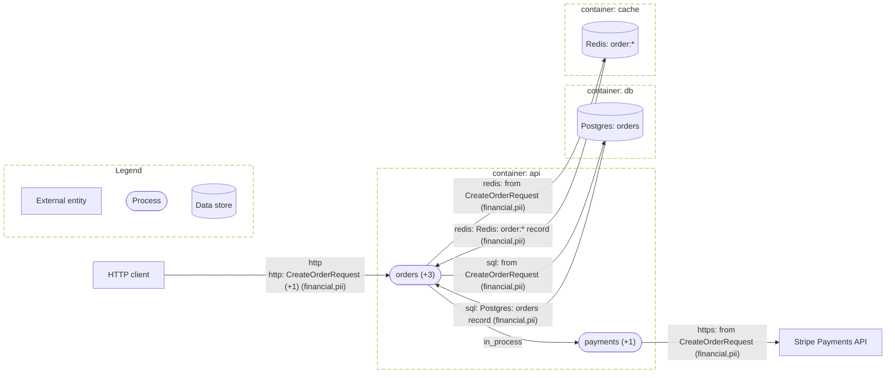

# Worked example: orders-service

A small Express service in `app/` with one router, a Postgres table, a Redis cache and an outbound call to Stripe. `output/` is exactly what the tool writes for it (except `facts.jsonl`, which is left out to keep the example short):

```bash
code2design analyze examples/orders-service/app --out examples/orders-service/output --name orders-service
node scripts/check-mermaid.js examples/orders-service/output/diagrams      # every diagram parses and renders
code2design verify examples/orders-service/output/model.ir.json --repo examples/orders-service/app
```

## 1. Source and what the detectors see

| File | Facts |
|---|---|
| `app/src/index.ts` | The app, `requireJwt` (authn) and `rateLimit` (rate_limit) registered in that order, the orders router mounted at `/orders`, the listener on port 8080 |
| `app/src/orders/routes.ts` | Two routes; the zod schema `CreateOrderRequest` (`customerEmail`, `shippingAddress`, `items`, `cardToken`); `CreateOrderRequest.parse(req.body)` inside the POST handler, an in-handler `input_validation` control |
| `app/src/orders/service.ts` | `INSERT` and `SELECT` on `orders` (the SQL also yields the `orders` row schema), `redis.set`/`redis.get` on `order:*`, the call to `chargeCard` |
| `app/src/payments/stripe.ts` | Stripe SDK `charges.create`; `STRIPE_SECRET_KEY` from the environment (a credential asset) |
| `app/docker-compose.yml` | Three services (`api`, `db`, `cache`), the published port of `api` (so its entry points are `public`), and `DATABASE_URL`/`REDIS_URL` naming the `db` and `cache` hosts |
| `app/.code2design/overrides.yaml` | Human input: Postgres declared encrypted at rest (with an expiry), Stripe renamed, a "rogue merchant operator" threat agent, and one deliberately stale entry |

## 2. Model (`output/model.ir.json`)

| Collection | Count | Notes |
|---|---|---|
| processes | 9 | L0 root; L1 `orders` and `payments`; L2 one process per handler function plus the `service` and `stripe` modules |
| entities | 2 | The inbound HTTP client; Stripe (renamed by the override, `code_name` kept) |
| stores | 2 | `Postgres: orders` (pii, financial; encryption at rest declared), `Redis: order:*` (pii, financial) |
| boundaries | 3 | One per compose service |
| flows | 11 | Inbound requests, handler-to-module calls, reads and writes with direction, the Stripe call |
| entry_points | 2 | Full paths with `{id}` parameters, `exposure: public`, controls in execution order, `call_chain`, `reaches` |
| controls | 3 | `requireJwt`, `rateLimit`, `CreateOrderRequest.parse` |
| schemas | 3 | The request body, its `items` element, and the `orders` row; fields carry data classes |
| assets | 3 | PII, financial data, the Stripe secret |
| threat_agents | 5 | Anonymous and authenticated callers, an insider in the api container, a compromised Stripe, and the declared rogue operator |
| gaps | 5 | The TLS question for the listener, the two store-link questions, Redis encryption at rest, and the stale override. The Postgres encryption question is gone because the override answered it |

`POST /orders` reaches `Postgres: orders`, `Redis: order:*` and `Stripe Payments API` through `service.createOrder` and `stripe.chargeCard`; `GET /orders/{id}` reaches only the two stores. Each request flow into a store is labelled with the request schema whose data reaches it (`from CreateOrderRequest`).

## 3. Diagrams (`output/diagrams/`)

`dfd-l0.mmd` (context), `dfd-l1.mmd` (below), one `dfd-l2-*.mmd` per L1 process, and one `flow-*.mmd` sequence diagram per entry point: caller, controls in execution order with the rejection path of the authentication check, handler, called modules, and the stores and services it reaches.



## 4. Threat-model views

* `stride-table.md`: STRIDE per element, weaknesses first, then the exit point (financial and personal data leaving for Stripe) and the open questions on boundary-crossing links, then the rest; a data-asset table says where each data class is processed, stored and where it leaves.
* `traceability-matrix.md`: for each threat agent and asset, the route that crosses the fewest blocking controls. The authenticated caller reaches PII with authentication but no authorization check on the path, which is flagged for object-level access review; the anonymous caller is blocked by `requireJwt`, with the unanswered link attributes named.
* `model.otm.json` (OTM 0.2.0) and `findings.sarif` (SARIF 2.1.0) for threat modeling tools and code scanning.

## 5. What a pull request would show

If a PR added an SMS notification through Twilio in `createOrder`, `code2design diff` would list one new external entity, one new flow from `service` to it carrying `pii` across the `api` boundary, and `POST /orders` gaining a new `reaches` entry, security-relevant changes first. Every existing element keeps its ID, because identities contain no line numbers.
