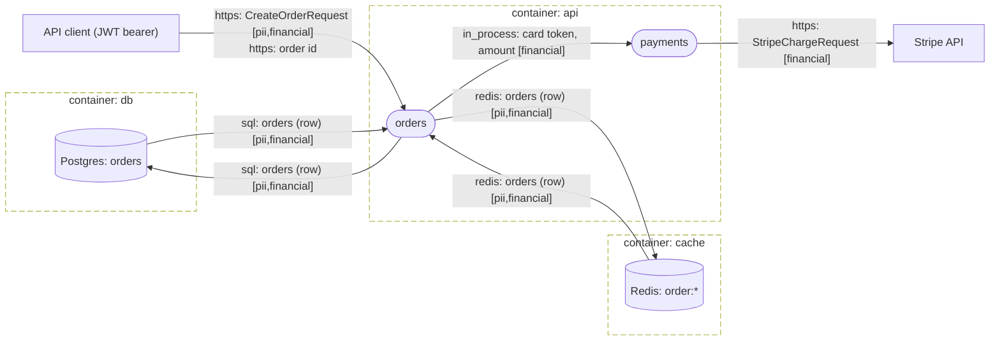

# Worked example: orders-service

A small Express service in `app/` with one router, a Postgres table, a Redis cache, and an outbound call to Stripe. The `output/` directory is what the tool would write to `.code2design/` for this repository. `generate.py` is a hand-driven stand-in for the detectors, but its ID scheme, roll-up, lint and renderers follow `docs/design.md` exactly, and it validates the IR against `schema/dfd-ir.schema.json`.

Reproduce:

```bash
python3 examples/orders-service/generate.py .
```

Check that every diagram parses and renders:

```bash
node scripts/check-mermaid.js examples/orders-service/output
```

## 1. Source

| File | What the detectors see |
|---|---|
| `app/src/index.ts` | App-level middleware order (JWT at line 8, rate limit at line 9), router mount at `/orders` (line 10). |
| `app/src/infra/auth.ts` | `requireJwt` authn control. `JWT_PUBLIC_KEY` comes from env; recorded as a gap because its source is not knowable statically. |
| `app/src/infra/db.ts`, `app/src/infra/cache.ts` | `pg` pool and `ioredis` client construction, keyed by `DATABASE_URL` and `REDIS_URL`. |
| `app/src/orders/routes.ts` | Two entry points (`POST /`, `GET /:id`), a zod request schema with `customerEmail`, `shippingAddress`, `cardToken`, and the validation call at line 15. |
| `app/src/orders/service.ts` | `INSERT INTO orders ...` (write), `SELECT * FROM orders` (read), `redis.set`/`redis.get` on `order:*`, and the call to `chargeCard`. The SQL literal also yields the `orders` row schema. |
| `app/src/payments/stripe.ts` | Stripe SDK `charges.create` outbound call, `STRIPE_SECRET_KEY` from env. |
| `app/docker-compose.yml` | Three containers (`api`, `db`, `cache`), used as trust boundaries. |

## 2. Facts (`output/facts.jsonl`)

26 flat facts, one per line, each with an evidence span and the detector that produced it. Example:

```json
{"id": "fact_005", "kind": "entry_point", "protocol": "http", "method": "POST", "path": "/orders", "symbol": "src/orders/routes.ts::ordersRouter.post#/", "evidence": {"path": "src/orders/routes.ts", "start_line": 14, "end_line": 18, "detector": "express-routes@1.2"}}
```

## 3. IR (`output/model.ir.json`)

| Collection | Count | Notes |
|---|---|---|
| processes | 8 | L0 root, L1 `orders` and `payments`, L2 handlers and service functions. |
| entities | 2 | Inbound API client; Stripe API. |
| stores | 2 | `Postgres: orders`, `Redis: order:*`. |
| boundaries | 3 | One per compose service. |
| flows | 10 | Stored at the finest level (L2); L1 and L0 views roll them up to ancestors. |
| entry_points | 2 | With ordered `controls` and `call_chain`. |
| controls | 3 | authn, rate_limit, input_validation. |
| weaknesses | 1 | `STRIPE_SECRET_KEY` read at module import (a provable negative finding). |
| schemas | 3 | Request body, `orders` row, Stripe charge request. Fields carry data classes. |
| gaps | 4 | No ingress IaC; JWT key source unresolved; two `unknown_attribute` questions for the team (TLS and encryption at rest on the Postgres and Redis links). |

IDs are `kind:base32(sha256(identity tuple))[:10]`, and the identity tuple is kept in the clear. Every evidence span carries a `content_hash` of its text, and `provenance.input_hashes` records every file that produced a fact. Flows carry `authentication` and `encryption` (Threagile-compatible values, `unknown` when not derivable from code); stores carry `encryption_at_rest`. The `create order` process carries `origin: inferred` because its description came from the enrichment stage; it renders dashed.

## 4. Diagrams

* `output/dfd-l0.mmd`: context diagram, one process.
* `output/dfd-l1.mmd`: `orders` and `payments` inside the `api` container, stores in their own containers, Stripe and the client outside.
* `output/dfd-l2-orders.mmd`: handlers and service functions.
* `output/flow-post-orders.mmd`, `output/flow-get-order.mmd`: control flow per entry point as a sequence diagram. Middleware appears in registration order, and calls appear in source order (charge, insert, cache), which is what makes the diagram match the code rather than the discovery order.

L1:



## 5. Threat model export (`output/stride-table.md`)

One row per element with the applicable STRIDE categories, data classes, boundary crossings and existing controls. Rows with a priority hint come first: the Stripe call is an *exit point* (financial data leaves the system), the secret-at-import weakness, and the store links whose authentication and encryption are `unknown` and therefore listed as questions for the team. A data-asset table at the end answers "where is PII processed, stored, and where does it leave" without reading the diagram.

## 6. What a PR would show

If a later PR added an SMS notification via Twilio in `createOrder`, the design delta would list one new external entity, one new flow from `create order` to it carrying `pii` (the phone number) across the `api` boundary with no control, and nothing else. The 10 existing flows keep their IDs because their identity tuples are unchanged.
